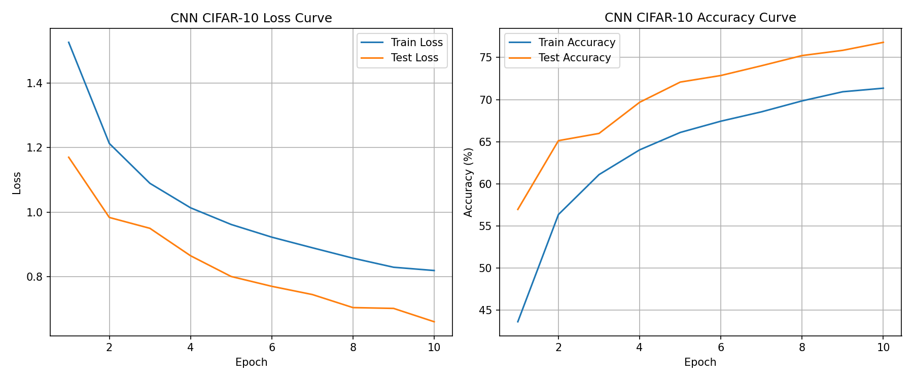
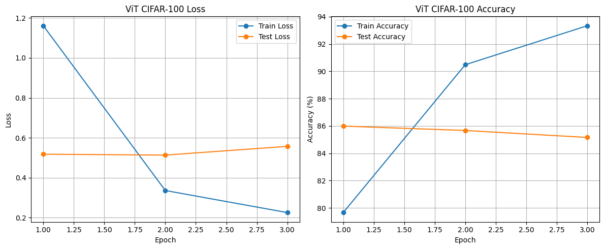

# Báo cáo Thực tập Phase 3: Nghiên cứu Mạng Neural trong Nhận dạng Ảnh

* **Sinh viên thực hiện:** Đỗ Văn Trường
* **Lớp:** 2310A01 
* **Mã sinh viên:** [23A1001D0382]
* **Đơn vị đào tạo:** Khoa Công Nghệ Thông Tin - Trường Đại Học Mở Hà Nội.

---

## 1. Tổ chức Thư mục trên GitHub

* `notebooks/3_1_CNN_CIFAR10.ipynb` : Mã nguồn huấn luyện và đánh giá mạng CNN cơ bản trên CIFAR-10.
* `notebooks/3_2_ViT_CIFAR100.ipynb` : Mã nguồn nghiên cứu và áp dụng mô hình hiện đại trên CIFAR-100.
* `results/cifar10_learning_curve.png` : Biểu đồ theo dõi quá trình học (Loss / Accuracy) của CNN trên CIFAR-10.
* `results/cifar100_eval_results.png` : Biểu đồ kết quả đánh giá mô hình trên CIFAR-100.
* `README.md` : Tài liệu tổng hợp lý thuyết, quy trình thực hiện và kết quả thực nghiệm.

---

## 2. Phần 3.1: Cài đặt Mạng CNN Cơ bản với Dữ liệu CIFAR-10

### Dữ liệu & Tiền xử lý
* Bộ dữ liệu **CIFAR-10** gồm 60.000 ảnh màu `32x32` thuộc 10 lớp (50.000 ảnh train, 10.000 ảnh test).
* Tiền xử lý gồm chuẩn hóa giá trị điểm ảnh và áp dụng một số phép biến đổi trên tập huấn luyện (`RandomHorizontalFlip`, `RandomCrop`) nhằm tăng tính khái quát cho mô hình.

### Kiến trúc Mạng CNN Cơ bản
* Các lớp tích chập (`Conv2d`), chuẩn hóa (`BatchNorm2d`), hàm kích hoạt (`ReLU`) và gộp cực đại (`MaxPool2d`) trích xuất đặc trưng từ ảnh đầu vào.
* Khối phân loại (`Flatten`, `Dropout`, `Linear`) ánh xạ đặc trưng sang đầu ra 10 lớp của CIFAR-10.

### Kết quả Thực nghiệm
* Số epochs: `[Điền số epoch]`
* Train Loss / Test Loss: `[Điền train loss]` / `[Điền test loss]`
* Test Accuracy: `[Điền test acc]%`
* Biểu đồ kết quả:

---

## 3. Phần 3.2: Nghiên cứu Mạng Neural Hiện đại & Ứng dụng trên CIFAR-100

### Tìm hiểu Kiến trúc Hiện đại
* **CNN:** Khai thác đặc trưng không gian cục bộ qua bộ lọc trượt, phù hợp xử lý nhanh nhưng phạm vi tiếp nhận mở rộng dần theo độ sâu.
* **Transformer & Vision Transformer (ViT):** Chia ảnh thành các patch, thêm mã hóa vị trí và dùng Self-Attention để nắm bắt mối liên hệ toàn cục giữa các vùng ảnh.
* **GAN:** Gồm Generator và Discriminator huấn luyện đối kháng, ứng dụng chính trong việc sinh ảnh mới hoặc tạo dữ liệu bổ sung.
* **FPN:** Xây dựng tháp đặc trưng đa tỷ lệ giúp mô hình nhận diện tốt đối tượng ở nhiều kích thước khác nhau.

### Ứng dụng trên CIFAR-100
* Tập **CIFAR-100** có 60.000 ảnh `32x32` chia thành 100 lớp (mỗi lớp ít mẫu hơn so với CIFAR-10), đặt ra bài toán phân loại nhiều lớp chi tiết hơn.
* Trong thực nghiệm, mô hình **ViT** pre-trained từ Hugging Face (`google/vit-base-patch16-224`) được tinh chỉnh (fine-tune) với đầu ra 100 lớp trên môi trường Colab/Kaggle.

### Kết quả Thực nghiệm
* Test Accuracy trên CIFAR-100: `[Điền test acc]%`
* Nhận xét: Việc kế thừa trọng số pre-trained từ Hugging Face giúp mô hình đạt độ chính xác cao và ổn định nhanh hơn so với huấn luyện từ đầu trên tập 100 lớp.
* Biểu đồ kết quả:

---

## 4. Liên kết Mã nguồn & Nộp Báo cáo

* **GitHub Repository:** `https://github.com/truong6478-svg/Videal-Internship-Phase3-Image-Classification`
* **Notebook 3.1 (Colab/Kaggle):** [`notebooks/3_1_CNN_CIFAR10.ipynb`](notebooks/3_1_CNN_CIFAR10.ipynb)
* **Notebook 3.2 (Colab/Kaggle):** [`notebooks/3_2_ViT_CIFAR100.ipynb`](notebooks/3_2_ViT_CIFAR100.ipynb)
* **Danh sách nhóm thực tập:** `[Dán hoặc ghi chú đã cập nhật link repo vào bảng danh sách nhóm thực tập]`
